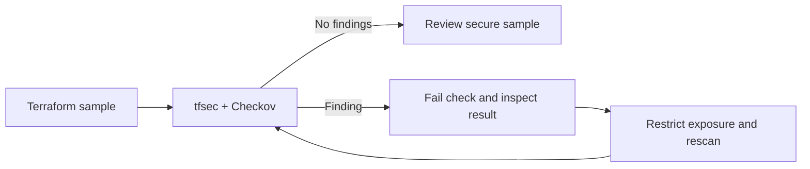

<div align="center">

# Terraform DevSecOps Security Lab

### Detect · Understand · Remediate · Verify


**A hands-on IaC security lab with intentionally vulnerable and remediated examples.**

</div>

> [!CAUTION]
> `samples/insecure` is deliberately vulnerable training material. **Do not apply it**, connect it to a real network, or copy its public SSH rule into a workload. The examples contain no credentials and are never deployed by the scan script.

## At a glance

| Sample | Expected scanner result | Purpose |
| --- | --- | --- |
| `samples/secure` | Both scanners pass | Baseline example with restricted SSH source |
| `samples/insecure` | Both scanners report public SSH | Verify detection and failure behavior |

## Contents

- [Detection workflow](#detection-workflow)
- [Samples](#samples)
- [Install pinned tools](#install-pinned-tools)
- [Run scans](#run-scans)
- [Findings and remediation](#finding-and-remediation)
- [CI and validation](#ci-integration-and-failure-behavior)

### Detection workflow



## Samples

| Sample | Demonstration | Expected outcome |
| --- | --- | --- |
| `samples/insecure` | Inbound SSH (`22/TCP`) from any source (`*`) | At least one scanner should report a finding |
| `samples/secure` | SSH restricted to a reserved documentation `/32` range | Scanners should pass; replace the reserved range before any real use |

The secure example is still an educational snippet, not a production network design. Prefer eliminating direct SSH exposure and using a controlled management path such as Azure Bastion or a private management network.

## Install pinned tools

The PowerShell installer pins Checkov and downloads the official tfsec Windows release, verifying its published SHA-256 checksum before extraction. tfsec continues to be available, though its maintainers direct new engineering attention to Trivy. Review upstream status and compatibility before changing these versions:

```powershell
.\scripts\Install-Tools.ps1
```

The installer uses Python 3.12 or newer, `tar.exe`, and network access to PyPI and the official tfsec GitHub release. It places tools in ignored `.venv/` and `.tools/` directories.

## Run scans

From the repository root:

```powershell
.\scripts\Invoke-Scans.ps1 -Sample secure
.\scripts\Invoke-Scans.ps1 -Sample insecure
```

The secure mode fails if either scanner exits nonzero. The insecure mode confirms that **both** tools report the expected public-SSH finding (`tfsec` public SSH ingress and Checkov `CKV_AZURE_10`). A missing expected finding or scanner/runtime error is reported as a failure; it is not treated as a successful security test. The script never suppresses findings.

## Finding and remediation

- **Unrestricted administrative ingress:** Any-source SSH can expose management access to the internet and expands brute-force and exploit risk. Restrict source ranges at minimum, avoid public SSH where possible, and use private access paths with identity controls.
- **Secure sample:** The rule uses a single reserved documentation CIDR as a nonfunctional placeholder. Replace it with a verified trusted range only if direct SSH is explicitly required; use a jump host/Bastion pattern where appropriate.
- **Additional review:** Verify effective NSG rules, subnet association, routing, identity controls, patching, logging, and the complete network path. A static scan cannot prove a deployment is secure.

## CI integration and failure behavior

The separate Azure DevOps Terraform pipeline portfolio project demonstrates fail-on-findings tfsec and Checkov steps on a Windows self-hosted agent. Run scans against a secure baseline as a required pull-request check. Keep the insecure sample isolated from deployment roots; use it only in an intentional detection exercise and review its output.

Scanner exit codes are treated as failures in the secure path. Do not add `--soft-fail`, broad suppressions, or blanket exclusions to force CI green. For a genuine false positive, first verify the resource and scanner rule, document the rationale and owner, define a narrow/time-bound exception in the project's approved process, and retain the finding in review records. This lab contains no suppression or false-positive exception.

## Validation

Terraform formatting and backend-free validation can be run without Azure credentials:

```powershell
terraform fmt -check -recursive
Set-Location samples/secure
terraform init -backend=false
terraform validate
```

No command in this lab provisions Azure resources. `terraform validate` validates syntax/provider schema; the intentionally insecure and secure samples are not deployment instructions.

---

<div align="center">

Part of the [Azure DevOps portfolio](https://github.com/komal324mane) · [Terraform infrastructure](https://github.com/komal324mane/terraform-azure-infrastructure) · [Pipeline lab](https://github.com/komal324mane/azure-devops-terraform-pipeline)

</div>
